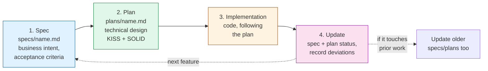

A minimalist spec kit for agentic development. One command drops a small set
of `AGENTS.md` files into your project so AI agents (and humans) work from a
single closed loop — **spec → plan → implementation → update** — instead of
ad-hoc prompting. It works on projects in any language.

> **Study project.** SpaceKid is a personal project built to learn and evolve
> my own knowledge of AI-assisted development. It is public so it can be read,
> tried and discussed, but it is not a supported product: expect rough edges,
> breaking changes and no stability guarantees.

## Quick start

With Docker installed, three steps take you from nothing to a scaffolded
project. Works on macOS (Apple Silicon and Intel) and Linux; the image is
native on both, with no extra flags.

**Requirements.** A container runtime:
[Docker Desktop](https://docs.docker.com/desktop/setup/install/mac-install/),
[OrbStack](https://orbstack.dev/) or [Colima](https://github.com/abiosoft/colima)
on macOS; [Docker Engine](https://docs.docker.com/engine/install/) on Linux.

**1. Download the image (once).**

```bash
docker pull victorradael/spacekid
```

**2. Create the `spacekid` command (once).** This adds a shortcut to your
shell profile so it survives new terminals. Use `~/.zshrc` for zsh (the macOS
default) or `~/.bashrc` for bash (`~/.bash_profile` on macOS):

```bash
cat >> ~/.zshrc <<'EOF'
alias spacekid='docker run -it --rm -e NO_COLOR -u "$(id -u):$(id -g)" -v "$PWD:/project" victorradael/spacekid'
EOF
source ~/.zshrc
```

For fish, run `alias --save spacekid 'docker run -it --rm -e NO_COLOR -u (id -u):(id -g) -v $PWD:/project victorradael/spacekid'` instead.

**3. Use it, from the root of your project.**

```bash
spacekid init
```

```
mode: project
created: AGENTS.md
created: specs/AGENTS.md
created: plans/AGENTS.md
```

From now on, `spacekid` is all you type.

In a color terminal, `init` prints a banner and color-coded results
(✔ created, ✚ appended, • skipped). Run `spacekid` with no arguments to open an
interactive menu (initialize a project, initialize a multi-repo directory,
about, quit). When output is piped or redirected, or `NO_COLOR` is set, the
output stays plain text, and running `spacekid` with no arguments prints the
usage help instead.

### What the shortcut does

The shortcut is a short name for a longer Docker command:

| Part | Meaning |
|---|---|
| `docker run` | Start the SpaceKid container. |
| `--rm` | Delete the container when it finishes. Nothing is left behind. |
| `-it` | Connect your terminal to the container, so colors and the interactive menu work. Without it, SpaceKid prints plain text. |
| `-e NO_COLOR` | Pass your `NO_COLOR` setting through, so opting out of color still works. |
| `-u "$(id -u):$(id -g)"` | Run as you, so created files belong to you instead of `root`. |
| `-v "$PWD:/project"` | Give the container your current folder as `/project`. Without it, files are created inside the container and lost. |
| `victorradael/spacekid` | The image to run. |

## Install

SpaceKid is a command-line tool, distributed as a container image. Follow the
[Quick start](#quick-start). To pin a version, use an image tag in both
`docker pull` and the shortcut:

| Tag | Meaning |
|---|---|
| `victorradael/spacekid:1.1.1` | an exact release (example; see all tags on Docker Hub) |
| `victorradael/spacekid:1.2` | the latest patch of that minor version |
| `victorradael/spacekid:latest` | the most recent release (default) |

Check the version with `spacekid --version`.

## Commands and options

```
spacekid [--version] [-h] init [--path PATH] [--name NAME] [--mode {auto,project,brain}]
```

| Command / option | Description |
|---|---|
| `--version` | Print the installed version and exit. |
| `-h`, `--help` | Show help. Also works after `init`. |
| `init` | Scaffold the SpaceKid files. The only command. |
| `init --path PATH` | Directory to scaffold into. It must already exist. Default: current directory. |
| `init --name NAME` | Project name written into `AGENTS.md`. Default: the `name` in `pyproject.toml` if present, otherwise the directory name. |
| `init --mode MODE` | `project`, `brain`, or `auto` (default). See [Choosing a mode](#choosing-a-mode). |

Put the options after `init`. The shortcut already mounts the current
folder, so `--path` is rarely needed:

```bash
spacekid init --name "My App"
```

## Choosing a mode

SpaceKid has two modes.

- **Project mode** — for a single repository. Adds the workflow files at the
  project root.
- **Brain mode** — for a folder that holds several repositories side by side.
  Adds a `brain/` folder that coordinates work across them.

With `--mode auto` (the default), `init` picks for you and prints the choice
on its first line:

1. If the directory itself has a `.git`, it is **project** mode.
2. Otherwise, if two or more of its direct child folders have a `.git`, it is
   **brain** mode.
3. Anything else is **project** mode.

Force a mode with `--mode project` or `--mode brain`.

### Project mode

```
my-app/
├── AGENTS.md          # entry point: file map, the cycle, the update rule
├── specs/
│   └── AGENTS.md      # how to write a spec
└── plans/
    └── AGENTS.md      # how to write an implementation plan
```

```
$ spacekid init
mode: project
created: AGENTS.md
created: specs/AGENTS.md
created: plans/AGENTS.md
```

### Brain mode

For a layout like this (`api` and `web` are git repositories, the parent is
not):

```
workspace/
├── api/.git
└── web/.git
```

```
$ spacekid init
mode: brain
created: brain/AGENTS.md
created: brain/sdd/specs/AGENTS.md
created: brain/sdd/plans/AGENTS.md
created: brain/contexts/.gitkeep
created: brain/artifacts/.gitkeep
```

```
workspace/
├── api/
├── web/
└── brain/
    ├── AGENTS.md          # folder map, placement rule, and the flow
    ├── contexts/          # knowledge produced while working
    ├── artifacts/         # every other generated file
    └── sdd/
        ├── specs/AGENTS.md
        └── plans/AGENTS.md
```

`brain/AGENTS.md` sets the placement rule (knowledge goes to `contexts/`,
every other generated file to `artifacts/`) and a flow that starts with a
mandatory context step before any work. The `.gitkeep` files keep the empty
folders in version control.

## Existing files and repeated runs

`init` never deletes or overwrites your content. For each file it reports one
of three outcomes:

| Message | When | What happened |
|---|---|---|
| `created: <file>` | the file did not exist | written from the template |
| `appended to: <file>` | `specs/AGENTS.md`, `plans/AGENTS.md` (and their brain-mode equivalents) exist but do not contain the SpaceKid rules | the standard rules were added to the end; your content is kept |
| `skipped (already exists): <file>` | the file exists and needs nothing: `AGENTS.md`, `brain/AGENTS.md`, the `.gitkeep` files, or a rule file that already contains the SpaceKid rules | left untouched |

Running `init` again is safe: a project that is already scaffolded is left
exactly as it is, even if you edited the files around the rules.

```
$ spacekid init        # second run in the same project
mode: project
skipped (already exists): AGENTS.md
skipped (already exists): specs/AGENTS.md
skipped (already exists): plans/AGENTS.md
```

## The working loop

Every feature follows the same four steps, in this order:



1. **Spec** — write `specs/<name>.md`: what and why, in business terms
   (context, requirements, acceptance criteria). No code, no references to
   other files.
2. **Plan** — write `plans/<name>.md`: how to build it, the simplest design
   that satisfies the spec. It is the only file allowed to reference the spec.
3. **Implementation** — code exactly what the plan says, only after both
   files exist and are approved.
4. **Update** — as soon as the work is done, mark the plan `Done` (recording
   any deviation and why) and the spec `Implemented`, and update any other
   spec or plan whose behavior you touched.

The loop only closes at step 4. Each file points one way — plan to spec, never
the reverse — so every file reads on its own and any agent can resume cold:
read `AGENTS.md`, then the relevant spec and plan, and have the full picture
without digging through chat history.

## Troubleshooting

**`docker pull` fails or stops midway** (for example `connection reset by
peer`).
Run `docker pull victorradael/spacekid` again: layers already downloaded are
kept, so it resumes. If it keeps failing with an IPv6 address in the error
(like `[2600:9000:...]:443`), your IPv6 route to Docker is broken. **Linux
only:** disable IPv6, pull, then turn it back on (replace `wlp0s20f3` with your interface
from `ip -br link show up`):

```bash
# disable IPv6
sudo sysctl -w net.ipv6.conf.wlp0s20f3.disable_ipv6=1

docker pull victorradael/spacekid

# revert (enable IPv6 again)
sudo sysctl -w net.ipv6.conf.wlp0s20f3.disable_ipv6=0
```

Rebooting also reverts it. On macOS there is no equivalent command: restart
Docker Desktop (or OrbStack/Colima), check your network or VPN, and try again.

**`spacekid: command not found` after the Quick start.**
The shortcut is not loaded in this terminal. Run `source ~/.zshrc` (or
`source ~/.bashrc`; `source ~/.bash_profile` for bash on macOS), or open a new terminal, and check that the `alias` line
is in your profile.

**Files created by Docker belong to `root` (or another user).**
Use the `spacekid` shortcut from the Quick start, which already includes
`-u "$(id -u):$(id -g)"`. To
fix files already created (Linux): `sudo chown -R "$(id -u):$(id -g)" specs plans AGENTS.md`.

On macOS the same shortcut works (`id -u` and `id -g` return your macOS user
and group, and Docker Desktop shares the folder with your ownership). The
`chown` fix above is Linux-only; on macOS use `sudo chown -R "$(id -u):$(id -g)" specs plans AGENTS.md` as well if you ever need it.

**`permission denied` when the container writes.**
The container user needs write access to the mounted directory. Run with `-u
"$(id -u):$(id -g)"` and make sure you own the directory.

**Nothing appears in my project after `docker run`.**
Check the volume: `-v "$PWD:/project"` must be present, and the container
works on `/project`. Without it, files are written inside the throwaway
container and lost.

**It chose brain mode (or project mode) and I wanted the other.**
Pass `--mode project` or `--mode brain`. See [Choosing a mode](#choosing-a-mode).

**`FileNotFoundError` with `--path`.**
The directory given to `--path` must exist. Create it first.

**Migrating from the npm package or a `pipx`/`pip` install.**
The container image is now the only way to use SpaceKid; the `spacekid` npm
package is retired and installing with `pipx` or `pip` is no longer supported.
Uninstall the old copy, then follow the [Quick start](#quick-start) to pull the
image and create the shortcut, and run `spacekid init` as before. The short
`sk` name is no longer part of the documented interface.

## Issues and contributing

- Report bugs and ideas at <https://github.com/victorradael/spacekid/issues>.
- Contributions are welcome as pull requests. This project follows its own
  loop: propose a spec in `specs/`, then a plan in `plans/`, then the code.
  Read `AGENTS.md` in the repository first.
- Commits follow [Conventional Commits](https://www.conventionalcommits.org/);
  releases are generated from them.
- The CLI is written in Python. That is an internal detail, not something
  users need. To run the tests locally, see [MAINTAINING.md](MAINTAINING.md).
- Maintainers: see [MAINTAINING.md](MAINTAINING.md).

## Repository layout

```
/AGENTS.md           # entry point: maps the repo, enforces the cycle
/specs/AGENTS.md     # how to write a good spec
/specs/<name>.md     # one per feature, business-only
/plans/AGENTS.md     # how to write a good implementation plan
/plans/<name>.md     # one per spec, technical design + status
/src/spacekid/       # the CLI
/Dockerfile          # container image wrapping the CLI
/DOCKERHUB.md        # Docker Hub page, synced on release
/MAINTAINING.md      # release process and maintainer setup
```

## Language

All documentation — specs, plans, `AGENTS.md` files, this README — is written
in English, regardless of the language used in conversation with the agent.
