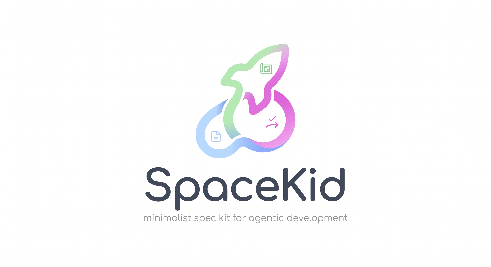
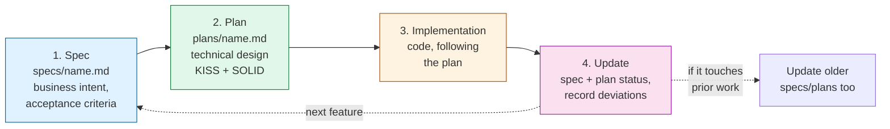

A minimalist spec kit for agentic development. The name is a play on
*"spec kit"* — a small, opinionated set of files that keeps AI agents (and
humans) working from a single, closed development loop instead of ad-hoc
prompting.

## Project status

> **This is a personal study project, not a production-ready tool.**

SpaceKid is built as a hands-on way to learn and evolve my own knowledge of
AI-assisted software development. The repository is public so the work can be
read, tried and discussed, but it is **an object of study and personal
development**, not a supported product.

The long-term ambition is to grow it into a full agentic workflow. Today it
is only the first piece: a spec/plan/implement/update loop and a command that
scaffolds it. Expect rough edges, breaking changes and shifting ideas, with
no stability or support guarantees.

## Install

SpaceKid is a command-line tool, not a library your code imports. It works on
projects in any language and is available in two ways: installed with Python,
or run from a container image. Both answer the same commands with the same
results.

### Option 1: install with Python

SpaceKid isn't published on PyPI yet, so install it straight from GitHub.
`pipx` is recommended: it installs the tool in its own isolated environment
and puts it on your `PATH`.

```bash
pipx install git+https://github.com/victorradael/spacekid.git
```

or, with `pip`:

```bash
pip install git+https://github.com/victorradael/spacekid.git
```

Pin a version by appending a tag, e.g. `@v0.1.0`:

```bash
pipx install git+https://github.com/victorradael/spacekid.git@v0.1.0
```

Both `spacekid` and the shorter `sk` are installed and behave identically.

### Option 2: run with Docker

No local install beyond a container runtime. Run it from your project
directory, passing your user id so created files belong to you, not to root:

```bash
docker run --rm -u "$(id -u):$(id -g)" -v "$PWD:/project" ghcr.io/victorradael/spacekid init
```

Pin a version by using its tag instead of `latest`:

```bash
docker run --rm -u "$(id -u):$(id -g)" -v "$PWD:/project" ghcr.io/victorradael/spacekid:0.1.0 init
```

A new image is published automatically for every release (`vX.Y.Z` tag).

## Usage

From the root of the project you want to adopt the workflow in:

```bash
spacekid init
```

This scaffolds `AGENTS.md`, `specs/AGENTS.md`, and `plans/AGENTS.md` in the
current directory:

- `AGENTS.md` is created with the project's name filled in (detected from
  `pyproject.toml`, or the directory name otherwise — pass `--name` to set
  it explicitly). If the project already has an `AGENTS.md`, it's left
  untouched.
- `specs/AGENTS.md` and `plans/AGENTS.md` are created if missing; if either
  already exists, the standard SpaceKid content is appended to the end of
  it instead of overwriting it.

Run `spacekid init --path <dir>` to scaffold a different directory than the
current one.

### Migrating from the npm package

The `spacekid` npm package is retired and no longer built or published. Use
either option above instead: `npx spacekid init` becomes
`docker run --rm -u "$(id -u):$(id -g)" -v "$PWD:/project" ghcr.io/victorradael/spacekid init`
(or `pipx install ...` once, then `spacekid init`). The scaffolded files are
the same, and the tool works on JavaScript/TypeScript projects too.

## Why a closed loop

Agentic coding tends to drift: an agent starts implementing before the
requirements are pinned down, technical decisions leak into what should be a
business document, and nothing records *why* the final implementation
differs from the original intent. Six months later, no file tells you what
was actually decided or why.

SpaceKid fixes this by making the workflow a **closed cycle across three
kinds of files**, each with exactly one job:

| File | Role | Contains |
|---|---|---|
| `specs/<name>.md` | **What & why** | Business context, requirements, acceptance criteria. No code. |
| `plans/<name>.md` | **How** | Technical design that satisfies the spec — KISS, SOLID, scalability, maintainability. |
| `AGENTS.md` | **Rules of the loop** | How agents navigate the repo and how the cycle must be followed. |

Each file only points in one direction: a plan may reference its spec, a
spec never references anything, and after implementation both loop back to
record their final status. This one-way referencing keeps specs readable in
isolation and prevents circular, tangled documentation.

## The cycle



1. **Spec** — Define *what* needs to be built and *why*, in pure business
   terms. No code, no architecture, no references to other files. See
   [`specs/AGENTS.md`](specs/AGENTS.md).
2. **Plan** — Once the spec is approved, design *how* to build it: the
   simplest approach that fully satisfies the spec, applying KISS and SOLID.
   This is the only file allowed to reference the spec. See
   [`plans/AGENTS.md`](plans/AGENTS.md).
3. **Implementation** — Code exactly what the plan describes. No spec, no
   plan, no implementation.
4. **Update (the step that's easy to forget)** — The moment implementation
   is done, the agent must go back and:
   - mark the plan `Done`, recording any deviation from the original design
     and why it was necessary;
   - mark the spec `Implemented`, updating acceptance criteria if reality
     forced a change;
   - update any *other* spec/plan pair whose behavior was affected along the
     way.

The loop only closes when step 4 happens. Skipping it is the single most
common way documentation rots — SpaceKid treats it as a non-negotiable part
of "done," not an optional cleanup step.

## Why this matters for agents specifically

Agents don't carry institutional memory between sessions the way a team
does. A closed, file-based loop means:

- **Simplicity by construction.** Splitting "what/why" from "how" stops
  business intent from getting buried under implementation detail — and
  keeps the plan honest about being the simplest design that works.
- **No silent drift.** Every implementation must reconcile itself against
  the spec and plan it came from, so the docs describe what was *actually*
  built, not just what was originally intended.
- **Any agent can resume cold.** Because each file is self-contained and the
  referencing direction is fixed, a new agent (or a new session) can read
  `AGENTS.md`, then the relevant spec and plan, and have full context without
  digging through chat history or commit logs.

## Repository layout

```
/AGENTS.md          # entry point: maps the repo, enforces the cycle
/specs/AGENTS.md     # how to write a good spec
/specs/<name>.md      # one per feature, business-only
/plans/AGENTS.md     # how to write a good implementation plan
/plans/<name>.md      # one per spec, technical design + status
/src/spacekid/      # the CLI (single implementation)
/Dockerfile          # container image wrapping the CLI
```

## Releasing

Versions are bumped manually in `pyproject.toml`. Pushing a tag `vX.Y.Z`
matching that version builds the container image and publishes it to GHCR as
`:X.Y.Z` and `:latest`.

## Language

All documentation — specs, plans, `AGENTS.md` files, this README — is
written in English, regardless of the language used in conversation with the
agent.
