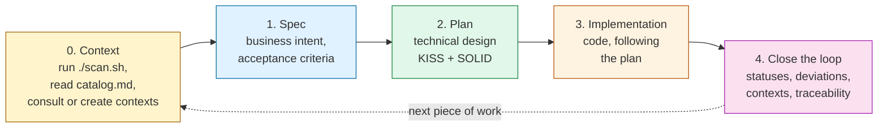

A minimalist spec kit for agentic development. One command creates a
**miniverse** in your directory: a small, self-contained world holding the
knowledge, the produced files and the spec-driven workflow that AI agents (and
humans) need to work well — instead of ad-hoc prompting. It works on projects
in any language.

> **Study project.** SpaceKid is a personal project built to learn and evolve
> my own knowledge of AI-assisted development. It is public so it can be read,
> tried and discussed, but it is not a supported product: expect rough edges,
> breaking changes and no stability guarantees.

## The flow

The flow is the heart of SpaceKid. Every piece of work goes through the same
steps, in this order, with no skipping:



0. **Context (mandatory first step).** Before any work, run the miniverse's
   `scan.sh` (it refreshes `catalog.md`), read the catalog, consult the
   existing contexts and create the missing ones the task depends on.
1. **Spec** — what and why, in business terms: context, requirements,
   acceptance criteria. No code. Carries a creation date, a last-updated date
   and a traceability section.
2. **Plan** — how to build it, the simplest design that satisfies the spec.
   Run `scan.sh` again before starting it.
3. **Implementation** — code exactly what the plan says, only after the spec
   and the plan exist and are approved.
4. **Close the loop** — as soon as the work is done, set the plan to `Done` and
   the spec to `Implemented`, record deviations, bring affected specs, plans
   and contexts up to date, and register every plan, context and artifact in
   the originating spec's traceability section (with the date it was added),
   refreshing the spec's last-updated date.

Around the loop:

- **Knowledge is a context, anything else is an artifact.** Findings,
  decisions and explanations are saved in `contexts/` (each with a one-line
  summary, a creation date and a last-updated date, so an agent can judge
  relevance without opening it). Diagrams, exports, reports and drafts go in
  `artifacts/`.
- **Miniverses nest, to any depth.** A miniverse can sit inside a directory
  covered by a higher-level one, which can sit inside another, and so on.
  `scan.sh` finds them by their `.miniverse` marker (not by folder name) and
  writes `catalog.md`: the projects the miniverse covers (or a statement that it
  belongs to a single project) and the path of every nested miniverse, as a tree.
  Agents use the catalog, never a file-tree search, to go to a nested
  miniverse, **reuse the contexts** already documented there and read its specs
  for limitations and decisions already taken.
- **Projects stay current.** `sync.sh` uses the catalog to find every level of
  repositories, logs the branch of each and runs `git pull --ff-only`;
  `./sync.sh --main` first moves each one to `main`.
- **Conflicts are resolved before work proceeds.** If a lower-level spec
  conflicts with a higher-level one, the higher level prevails unless it is
  deliberately updated. The higher the level, the higher the precedence.
- **Everything is traceable.** Each spec indexes the plans, contexts and
  artifacts created from it, each entry dated, so you can follow the process
  from rule to result.

Every file reads on its own, so any agent can resume cold: read the root
`AGENTS.md`, then `miniverse/AGENTS.md`, and follow the flow.

## Quick start

With Docker installed, three steps take you from nothing to a miniverse. Works on macOS (Apple Silicon and Intel) and Linux; the image is
native on both, with no extra flags.

**Requirements.** A container runtime:
[Docker Desktop](https://docs.docker.com/desktop/setup/install/mac-install/),
[OrbStack](https://orbstack.dev/) or [Colima](https://github.com/abiosoft/colima)
on macOS; [Docker Engine](https://docs.docker.com/engine/install/) on Linux.

**1. Download the image (once).**

```bash
docker pull victorradael/spacekid
```

**2. Create the `spacekid` command (once).** This adds a shortcut to your
shell profile so it survives new terminals. Use `~/.zshrc` for zsh (the macOS
default) or `~/.bashrc` for bash (`~/.bash_profile` on macOS):

```bash
cat >> ~/.zshrc <<'EOF'
alias spacekid='docker run -it --rm -e NO_COLOR -u "$(id -u):$(id -g)" -v "$PWD:/project" victorradael/spacekid'
EOF
source ~/.zshrc
```

For fish, run `alias --save spacekid 'docker run -it --rm -e NO_COLOR -u (id -u):(id -g) -v $PWD:/project victorradael/spacekid'` instead.

**3. Use it, from the directory you want to work in** — a single repository,
several repositories side by side, or an empty folder:

```bash
spacekid init
```

```
created: AGENTS.md
created: miniverse/AGENTS.md
created: miniverse/.miniverse
created: miniverse/scan.sh
created: miniverse/catalog.md
created: miniverse/contexts/AGENTS.md
created: miniverse/artifacts/AGENTS.md
created: miniverse/sdd/specs/AGENTS.md
created: miniverse/sdd/plans/AGENTS.md
created: miniverse/contexts/.gitkeep
created: miniverse/artifacts/.gitkeep
```

From now on, `spacekid` is all you type.

In a color terminal, `init` prints a banner and color-coded results
(✔ created, ✚ appended, • skipped). Run `spacekid` with no arguments to open an
interactive menu (create a miniverse, about, quit). When output is piped or redirected, or `NO_COLOR` is set, the
output stays plain text, and running `spacekid` with no arguments prints the
usage help instead.

### What the shortcut does

The shortcut is a short name for a longer Docker command:

| Part | Meaning |
|---|---|
| `docker run` | Start the SpaceKid container. |
| `--rm` | Delete the container when it finishes. Nothing is left behind. |
| `-it` | Connect your terminal to the container, so colors and the interactive menu work. Without it, SpaceKid prints plain text. |
| `-e NO_COLOR` | Pass your `NO_COLOR` setting through, so opting out of color still works. |
| `-u "$(id -u):$(id -g)"` | Run as you, so created files belong to you instead of `root`. |
| `-v "$PWD:/project"` | Give the container your current folder as `/project`. Without it, files are created inside the container and lost. |
| `victorradael/spacekid` | The image to run. |

## Install

SpaceKid is a command-line tool, distributed as a container image. Follow the
[Quick start](#quick-start). To pin a version, use an image tag in both
`docker pull` and the shortcut:

| Tag | Meaning |
|---|---|
| `victorradael/spacekid:1.1.1` | an exact release (example; see all tags on Docker Hub) |
| `victorradael/spacekid:1.2` | the latest patch of that minor version |
| `victorradael/spacekid:latest` | the most recent release (default) |

Check the version with `spacekid --version`.

## Commands and options

```
spacekid [--version] [-h] init [--path PATH] [--name NAME]
```

| Command / option | Description |
|---|---|
| `--version` | Print the installed version and exit. |
| `-h`, `--help` | Show help. Also works after `init`. |
| `init` | Create a miniverse. The only command. |
| `init --path PATH` | Directory to create the miniverse in. It must already exist. Default: current directory. |
| `init --name NAME` | Name written into the guides and the marker. Default: the `name` in `pyproject.toml` if present, otherwise the directory name. |

Put the options after `init`. The shortcut already mounts the current
folder, so `--path` is rarely needed:

```bash
spacekid init --name "My App"
```

## The miniverse

SpaceKid has a single model. Whatever the directory — a single repository,
several repositories side by side, or an empty folder — `init` creates the same
`miniverse/` folder plus a short root `AGENTS.md` that tells any agent to read
the miniverse's guide before doing anything.

```
workspace/
├── AGENTS.md              # short: this directory works through a miniverse
├── api/  web/             # your repositories, untouched (if any)
└── miniverse/
    ├── AGENTS.md          # the flow, folder map, placement rule, rules
    ├── .miniverse         # marker: what makes this folder a miniverse
    ├── scan.sh            # standalone script that writes catalog.md
    ├── sync.sh            # standalone script: log the branch and git pull every repo
    ├── catalog.md         # generated: projects covered + nested miniverses (paths)
    ├── contexts/          # knowledge produced while working
    │   └── AGENTS.md      # how to write a context
    ├── artifacts/         # every other generated file
    │   └── AGENTS.md      # how to organize artifacts
    └── sdd/
        ├── specs/AGENTS.md    # how to write a spec
        └── plans/AGENTS.md    # how to write an implementation plan
```

- Every folder that holds a kind of document has its own `AGENTS.md` with the
  structure and patterns its files follow. Agents read it before creating or
  editing anything there.
- `scan.sh` needs only a POSIX shell (`find`, `sort`, `sed`, `tr`, `cmp`, `mv`)
  and works without SpaceKid or Docker. Run it from the miniverse folder:
  `./scan.sh`. It never changes your repositories; it only reads them, looking
  for other miniverses. Repeated runs with nothing changed produce the same
  `catalog.md`.
- `sync.sh` needs only a POSIX shell and `git`. Run `./sync.sh` to log the
  branch of every repository at this level and at each nested miniverse's
  level and update it with `git pull --ff-only`, or `./sync.sh --main` to move
  each repository to `main` first. Repositories with uncommitted changes are
  never moved, a diverged branch is never merged, and one failing repository
  does not stop the others (the script exits `1` and says which ones need
  attention). It never asks for input.
- The `.gitkeep` files keep the empty folders in version control.
- Migration from the retired `project` and `brain` modes is manual: move your
  old root `specs/` and `plans/` (or `brain/sdd/`) into `miniverse/sdd/`.

## Existing files and repeated runs

`init` never deletes or overwrites your content. For each file it reports one
of three outcomes:

| Message | When | What happened |
|---|---|---|
| `created: <file>` | the file did not exist | written from the template |
| `appended to: <file>` | one of the four folder guides (`contexts`, `artifacts`, `sdd/specs`, `sdd/plans`) exists but does not contain the SpaceKid rules | the standard rules were added to the end; your content is kept |
| `skipped (already exists): <file>` | the file exists and needs nothing: `AGENTS.md`, `miniverse/AGENTS.md`, `.miniverse`, `scan.sh`, `catalog.md`, the `.gitkeep` files, or a folder guide that already contains the SpaceKid rules | left untouched |

Running `init` again is safe: a directory that already has a miniverse is left
exactly as it is, even if you edited the files around the rules.

```
$ spacekid init        # second run in the same directory
skipped (already exists): AGENTS.md
skipped (already exists): miniverse/AGENTS.md
skipped (already exists): miniverse/.miniverse
skipped (already exists): miniverse/scan.sh
skipped (already exists): miniverse/catalog.md
skipped (already exists): miniverse/contexts/AGENTS.md
skipped (already exists): miniverse/artifacts/AGENTS.md
skipped (already exists): miniverse/sdd/specs/AGENTS.md
skipped (already exists): miniverse/sdd/plans/AGENTS.md
skipped (already exists): miniverse/contexts/.gitkeep
skipped (already exists): miniverse/artifacts/.gitkeep
```

## Troubleshooting

**`docker pull` fails or stops midway** (for example `connection reset by
peer`).
Run `docker pull victorradael/spacekid` again: layers already downloaded are
kept, so it resumes. If it keeps failing with an IPv6 address in the error
(like `[2600:9000:...]:443`), your IPv6 route to Docker is broken. **Linux
only:** disable IPv6, pull, then turn it back on (replace `wlp0s20f3` with your interface
from `ip -br link show up`):

```bash
# disable IPv6
sudo sysctl -w net.ipv6.conf.wlp0s20f3.disable_ipv6=1

docker pull victorradael/spacekid

# revert (enable IPv6 again)
sudo sysctl -w net.ipv6.conf.wlp0s20f3.disable_ipv6=0
```

Rebooting also reverts it. On macOS there is no equivalent command: restart
Docker Desktop (or OrbStack/Colima), check your network or VPN, and try again.

**`spacekid: command not found` after the Quick start.**
The shortcut is not loaded in this terminal. Run `source ~/.zshrc` (or
`source ~/.bashrc`; `source ~/.bash_profile` for bash on macOS), or open a new terminal, and check that the `alias` line
is in your profile.

**Files created by Docker belong to `root` (or another user).**
Use the `spacekid` shortcut from the Quick start, which already includes
`-u "$(id -u):$(id -g)"`. To
fix files already created (Linux): `sudo chown -R "$(id -u):$(id -g)" miniverse AGENTS.md`.

On macOS the same shortcut works (`id -u` and `id -g` return your macOS user
and group, and Docker Desktop shares the folder with your ownership). The
`chown` fix above is Linux-only; on macOS use `sudo chown -R "$(id -u):$(id -g)" miniverse AGENTS.md` as well if you ever need it.

**`permission denied` when the container writes.**
The container user needs write access to the mounted directory. Run with `-u
"$(id -u):$(id -g)"` and make sure you own the directory.

**Nothing appears in my project after `docker run`.**
Check the volume: `-v "$PWD:/project"` must be present, and the container
works on `/project`. Without it, files are written inside the throwaway
container and lost.

**`FileNotFoundError` with `--path`.**
The directory given to `--path` must exist. Create it first.

**Migrating from the npm package or a `pipx`/`pip` install.**
The container image is now the only way to use SpaceKid; the `spacekid` npm
package is retired and installing with `pipx` or `pip` is no longer supported.
Uninstall the old copy, then follow the [Quick start](#quick-start) to pull the
image and create the shortcut, and run `spacekid init` as before. The short
`sk` name is no longer part of the documented interface.

## Issues and contributing

- Report bugs and ideas at <https://github.com/victorradael/spacekid/issues>.
- Contributions are welcome as pull requests. This project follows its own
  loop: start from context, then a spec in `miniverse/sdd/specs/`, then a plan in
  `miniverse/sdd/plans/`, then the code. Read `AGENTS.md` in the repository first.
- Commits follow [Conventional Commits](https://www.conventionalcommits.org/);
  releases are generated from them.
- The CLI is written in Python. That is an internal detail, not something
  users need. To run the tests locally, see [MAINTAINING.md](MAINTAINING.md).
- Maintainers: see [MAINTAINING.md](MAINTAINING.md).

## Repository layout

```
/AGENTS.md                         # short pointer to the miniverse
/miniverse/AGENTS.md               # the flow, folder map and rules
/miniverse/contexts/               # SpaceKid's own knowledge
/miniverse/sdd/specs/<name>.md     # one per feature, business-only
/miniverse/sdd/plans/<name>.md     # one per spec, technical design + status
/src/spacekid/       # the CLI
/Dockerfile          # container image wrapping the CLI
/DOCKERHUB.md        # Docker Hub page, synced on release
/MAINTAINING.md      # release process and maintainer setup
```

## Language

All documentation — specs, plans, contexts, `AGENTS.md` files, this README — is written
in English, regardless of the language used in conversation with the agent.
